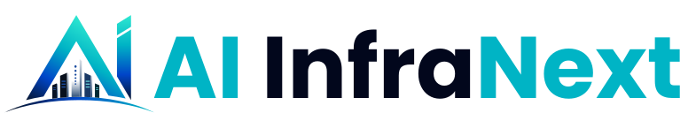

# AI InfraNext — Master Brand Identity & Logo Guidelines

**Document Control: Standards & Specifications Manual**  
**Version:** 1.0 (Master Enterprise Release)  
**Authorized By:** Global Corporate Design & Brand Architecture  
**Target Repository:** `Desktop / AI Infranext Logo`  
**Effective Date:** 2026–2027  

---

## Executive Summary & Brand Positioning

**AI InfraNext** represents the next generation of artificial intelligence compute architecture, high-density data center engineering, and global low-latency infrastructure. 

Our visual identity communicates:
1. **Architectural Resilience:** Structural solidity, reliability, and enterprise trustworthiness.
2. **Computational Velocity:** Electric energy, high-bandwidth interconnectivity, and processing speed.
3. **Illuminated Intelligence:** Clear, modern technological leadership and future-proof design.

This document establishes the definitive, legally protected visual standards for all internal teams, design agencies, technology partners, and authorized third-party vendors. Consistency across digital, physical, and print touchpoints is mandatory.

---

## 1. Logo Architecture & Approved Variations

The AI InfraNext logo system is built on a precise geometric relationship between the **Monogram Emblem** and the **Corporate Wordmark**.

```
[ Primary Monogram ] = Stylized "A" + Skyline Monolith + "I" Stem + Horizon Arc
[ Wordmark ]         = "AI" (Teal/Cyan) + "Infra" (Midnight/White) + "Next" (Teal/Cyan)
```

### Approved Lockup Configurations

| Asset Identifier | Configuration | Proportions | Light Mode Vector | Dark Mode Vector | Primary Mediums & Recommended Use Cases |
| :--- | :--- | :---: | :--- | :--- | :--- |
| **Lockup A (Primary)** | **Horizontal Lockup**<br>*(Artboard 2)* | `5.4 : 1` | [`assets/logo_horizontal_light.svg`](./assets/logo_horizontal_light.svg)<br>• *#02071C Midnight Wordmark* | [`assets/logo_horizontal_dark.svg`](./assets/logo_horizontal_dark.svg)<br>• *#FFFFFF Inverted Wordmark* | **The default corporate identity asset.**<br>• Website navigation headers & SaaS application chrome<br>• Corporate email signatures & correspondence<br>• Executive stationery, letterheads & business cards<br>• Horizontal event signage & digital media banners |
| **Lockup B (Secondary)** | **Stacked / Centered (by Trescon)**<br>*(Artboard 1)* | `1.34 : 1` | [`assets/logo_stacked_light.svg`](./assets/logo_stacked_light.svg)<br>• *#02071C Midnight Wordmark + By Trescon Lockup* | [`assets/logo_stacked_dark.svg`](./assets/logo_stacked_dark.svg)<br>• *#FFFFFF Inverted Wordmark + By Trescon Lockup* | **Emblematic & high-impact balance with official organiser attribution.**<br>• Mobile splash screens & desktop application startup<br>• Event stage podiums, pull-up banners & step-and-repeats<br>• Corporate merchandise, apparel, hardware chassis badges<br>• Document title covers & presentation cover slides |
| **Lockup C (Icon Only)** | **Standalone Monogram**<br>*(Artboard 4)* | `1 : 1` | [`assets/logo_icon_light.svg`](./assets/logo_icon_light.svg)<br>• *Transparent/Light Canvas* | [`assets/logo_icon_dark.svg`](./assets/logo_icon_dark.svg)<br>• *#07152F Squircle Container* | **Context-established micro & square surfaces.**<br>• Mobile operating system icons (iOS, Android)<br>• Official social media avatars (LinkedIn, X, GitHub, YouTube)<br>• App launcher tiles, docks & system tray indicators<br>• Technical architecture watermarks |
| **Lockup D (Micro Favicon)** | **Micro Silhouette Favicon**<br>*(Retina Optimized)* | `1 : 1` | [`assets/favicon_light_32.svg`](./assets/favicon_light_32.svg)<br>[`assets/favicon_light_16.svg`](./assets/favicon_light_16.svg) | [`assets/favicon_dark_32.svg`](./assets/favicon_dark_32.svg)<br>[`assets/favicon_dark_16.svg`](./assets/favicon_dark_16.svg) | **Sub-32px browser tabs & micro-indicators.**<br>• Web browser tab icons (16px, 32px, 48px)<br>• Browser bookmark bars & PWA web manifest tiles<br>• Omission of fine window slits prevents sub-pixel aliasing |
| **Lockup E (Sub-Brand)** | **"AI Next" Shortened**<br>*(Artboards 3 & 5)* | `2.6 : 1` | Master AI Artboard 5 | Master AI Artboard 3 | **Developer & product-suite extension.**<br>• Developer SDK portals, CLI tools & open-source repos<br>• Sub-product branding (e.g., AI Next Compute, AI Next Cloud)<br>• Responsive micro-headers (< 360px viewport width) |

---

## 2. Clear Space & Minimum Sizing Parameters

### The Clear Space Formula: The "X-Unit"
To preserve visual dominance, authority, and legibility, an unobstructed perimeter—free from all competing text, icons, photography, borders, or page boundaries—must surround every instance of the logo.

$$\text{Clear Space Margin} = 1.0\mathbf{X}$$

* **Definition of $\mathbf{X}$:** $\mathbf{X}$ is equal to the exact cap-height of the capital letter **`I`** in the wordmark, or the height of the circular apex dot on the stylized "I" of the monogram emblem.
* **Minimum Requirement:** Maintain at least **$1.0\mathbf{X}$** padding on top, bottom, left, and right.
* **Premium / Architectural Placement:** On corporate billboards, trade show booths, and report covers, expand the clear space to **$1.5\mathbf{X}$** or **$2.0\mathbf{X}$** to impart executive poise and breathing room.

```
       +-------------------------------------------------------------+
       |                           1.0 X                             |
       |       +---------------------------------------------+       |
       | 1.0 X |  [ MONOGRAM ]   AI InfraNext                | 1.0 X |
       |       +---------------------------------------------+       |
       |                           1.0 X                             |
       +-------------------------------------------------------------+
```

### Minimum Sizing Matrix

To safeguard fine structural vector details—specifically the architectural skyline window perforations—the logo must never be rendered below the following strict thresholds:

| Format / Variation | Digital Resolution (72–144 DPI) | Physical Print (300 DPI) |
| :--- | :---: | :---: |
| **Horizontal Lockup (Primary)** | Width: **`140 px`** | Width: **`38.0 mm`** (1.50 in) |
| **Stacked Lockup (Secondary)** | Width: **`100 px`** | Width: **`28.0 mm`** (1.10 in) |
| **Standalone Monogram Mark** | Size: **`24 × 24 px`**\* | Width: **`10.0 mm`** (0.40 in) |
| **Wordmark Only** | Width: **`90 px`** | Width: **`24.0 mm`** (0.95 in) |

*\*Favicon Exception (16px & 24px): For browser favicons below 32px, use the specialized micro-asset where the skyline window slits are omitted to prevent pixel sub-sampling noise.*

---

## 3. Comprehensive Master Color Palette

The AI InfraNext color system is engineered using high-chroma spectral stops that maintain crisp legibility across standard sRGB, wide-gamut Display P3, digital UI surfaces, and physical offset printing (CMYK & Pantone Matching System).

### Primary Core Brand Palette

#### 1. Infra Navy — The Structural Foundation
*The deep bedrock representing enterprise security, data center architecture, and foundational stability.*
* **HEX:** `#07152F`
* **RGB:** `rgb(7, 21, 47)`
* **Normalized RGB:** `r: 0.027, g: 0.082, b: 0.184`
* **CMYK (FOGRA39):** `C: 85%, M: 55%, Y: 0%, K: 82%`
* **Pantone (Coated):** `PMS 534 C`
* **Pantone (Uncoated):** `PMS 534 U`
* **HSL:** `219°, 74%, 11%`
* **Application:** Primary dark-theme background, shadow anchor of the monogram, executive documents.

#### 2. Infra Midnight — The Wordmark Core
*An ultra-dense midnight tone formulated for maximum typographic contrast and optical weight.*
* **HEX:** `#02071C`
* **RGB:** `rgb(2, 7, 28)`
* **Normalized RGB:** `r: 0.008, g: 0.027, b: 0.110`
* **CMYK (FOGRA39):** `C: 93%, M: 75%, Y: 0%, K: 89%`
* **Pantone (Coated):** `PMS Black 6 C`
* **Pantone (Uncoated):** `PMS Black 6 U`
* **HSL:** `228°, 87%, 6%`
* **Application:** "Infra" wordmark on light surfaces, deepest structural occlusions.

#### 3. Next Cobalt — The High-Velocity Midtone
*The electric chromatic bridge that infuses computational energy and prevents desaturation.*
* **HEX:** `#0045C8`
* **RGB:** `rgb(0, 69, 200)`
* **Normalized RGB:** `r: 0.000, g: 0.271, b: 0.784`
* **CMYK (FOGRA39):** `C: 100%, M: 65%, Y: 0%, K: 22%`
* **Pantone (Coated):** `PMS 286 C`
* **Pantone (Uncoated):** `PMS 286 U`
* **HSL:** `219°, 100%, 39%`
* **Application:** Dynamic gradient midtone, active state UI highlights, secondary badges.

#### 4. Core Brand Cyan — The Identity Anchor
*The signature AI InfraNext brand color, embodying artificial intelligence, speed, and cloud clarity.*
* **HEX:** `#00B4C5` *(Typography alternate: `#01B2A6`)*
* **RGB:** `rgb(0, 180, 197)`
* **Normalized RGB:** `r: 0.000, g: 0.706, b: 0.773`
* **CMYK (FOGRA39):** `C: 100%, M: 9%, Y: 0%, K: 23%`
* **Pantone (Coated):** `PMS 312 C`
* **Pantone (Uncoated):** `PMS 312 U`
* **HSL:** `185°, 100%, 39%`
* **Application:** "AI" and "Next" typography, primary interactive buttons, product identity elements.

#### 5. Luminous Aquamarine — The Innovation Glow
*The radiant crest highlight symbolizing forward vision, edge intelligence, and peak energy.*
* **HEX:** `#2EE8D1`
* **RGB:** `rgb(46, 232, 209)`
* **Normalized RGB:** `r: 0.180, g: 0.910, b: 0.820`
* **CMYK (FOGRA39):** `C: 80%, M: 0%, Y: 10%, K: 9%`
* **Pantone (Coated):** `PMS 3242 C`
* **Pantone (Uncoated):** `PMS 3242 U`
* **HSL:** `173°, 79%, 55%`
* **Application:** Monogram apex glow, high-priority status indicators, dark-theme contrast accents.

---

### Architectural Neutrals (Skyline & Backgrounds)

| Neutral Name | HEX Code | RGB (sRGB) | CMYK | Purpose |
| :--- | :---: | :---: | :---: | :--- |
| **Skyline Blueprint** | `#39597F` | `57, 89, 127` | `55, 30, 0, 50` | Center building gradient base & secondary technical lines |
| **Skyline Shadow** | `#081124` | `8, 17, 36` | `78, 53, 0, 86` | Left-facet building shading |
| **Window Illumination** | `#48A6BE` | `72, 166, 190` | `62, 13, 0, 25` | Building window aperture illumination |
| **Pure Canvas White** | `#FFFFFF` | `255, 255, 255` | `0, 0, 0, 0` | Standard light background & reversed wordmark |
| **Surface Off-White** | `#F8FAFC` | `248, 250, 252` | `2, 1, 0, 1` | Modern digital card & application UI canvas |
| **Divider Slate** | `#E2E8F0` | `226, 232, 240` | `6, 3, 0, 6` | Subtle framing, container strokes & borders |

---

## 4. The Mathematical Gradient System

The AI InfraNext gradient is a **strictly monotonic luminance model**. It eliminates intermediate gray/muddy desaturation zones, ensuring a vibrant transition along structural lines of action.

### The 4-Stop Architecture Specification

$$\text{Gradient Flow} = \mathbf{Stop}_1 (0\%) \longrightarrow \mathbf{Stop}_2 (30\%) \longrightarrow \mathbf{Stop}_3 (65\%) \longrightarrow \mathbf{Stop}_4 (100\%)$$

| Stop # | Position | HEX Code | RGB Values | Midpoint | Chromatic Function |
| :---: | :---: | :---: | :---: | :---: | :--- |
| **01** | **`0.0%`** | `#07152F` | `rgb(7, 21, 47)` | `50%` | **Deep Foundation:** Grounded structural baseline |
| **02** | **`30.0%`** | `#0045C8` | `rgb(0, 69, 200)` | `50%` | **High-Chroma Bridge:** Prevents desaturation dip |
| **03** | **`65.0%`** | `#00B4C5` | `rgb(0, 180, 197)` | `50%` | **Brand Identity Core:** Harmonizes with typography |
| **04** | **`100.0%`** | `#2EE8D1` | `rgb(46, 232, 209)` | `—` | **Luminous Apex:** High-energy crest illumination |

### Geometric Vector Direction Rules

```
     Apex (100% #2EE8D1)
             /\
            /  \       [ "A" Leg Vector ]
           /    \      Angle: 60.0° Along diagonal spine
          /      \     Origin: (287, 336) -> Apex: (413, 122)
         /        \
        /__________\   [ Horizon Arc Vector ]
                       Angle: 0.0° Horizontal from left (0%) to right (100%)
  Base (0% #07152F)
```

1. **Stylized "A" Leg:** Vector angle **`60°`** (linear progression from bottom-left foundation straight along the diagonal spine to the apex).
2. **Stylized "I" Monogram:** Vector angle **`90°`** (linear vertical progression from bottom baseline upward to top dot).
3. **Horizon Arc:** Vector angle **`0°`** (linear horizontal progression from left tip across to the right tapering point, communicating aerodynamic acceleration).

---

## 5. Color Accessibility & Contrast Matrix (WCAG 2.1)

To comply with global accessibility legislation (Americans with Disabilities Act, European Accessibility Act, Section 508), the identity elements must meet **WCAG 2.1 Level AA and Level AAA** contrast minimums:

### Contrast Ratio Table

| Foreground Element | Background Surface | Contrast Ratio | WCAG Compliance Level | Permitted Application |
| :--- | :--- | :---: | :---: | :--- |
| **Infra Midnight (`#02071C`)** | Pure White (`#FFFFFF`) | **`19.4 : 1`** | **Pass AAA** (All Text) | Standard Wordmark & Headings |
| **Infra Navy (`#07152F`)** | Pure White (`#FFFFFF`) | **`16.8 : 1`** | **Pass AAA** (All Text) | Body Copy, Subheads, Cards |
| **Next Cobalt (`#0045C8`)** | Pure White (`#FFFFFF`) | **`5.8 : 1`** | **Pass AA** (Normal Text) | Interactive Links, Secondary Copy |
| **Core Cyan (`#00B4C5`)** | Pure White (`#FFFFFF`) | **`2.3 : 1`** | *Fail for body copy* | **Permitted for Large Logos/Icons Only** |
| **Pure White (`#FFFFFF`)** | Infra Navy (`#07152F`) | **`16.8 : 1`** | **Pass AAA** (All Text) | Inverted "Infra" Wordmark on Dark |
| **Luminous Aqua (`#2EE8D1`)** | Infra Navy (`#07152F`) | **`11.2 : 1`** | **Pass AAA** (All Text) | Inverted "AI Next" Copy on Dark |
| **Core Cyan (`#00B4C5`)** | Infra Navy (`#07152F`) | **`7.2 : 1`** | **Pass AAA** (All Text) | Badges & Data Highlights on Dark |

### Contrast Rules for Digital & UI Implementation
* **Rule 1 (The Light Background Rule):** When displaying the logo on white or light surfaces (`#FFFFFF` to `#F1F5F9`), the wordmark uses `#02071C` for "Infra" and `#00B4C5` for "AI" and "Next".
* **Rule 2 (The Dark Background Inversion Rule):** When displaying on dark navy or black surfaces (`#07152F`, `#02071C`, `#000000`), the "Infra" text **MUST invert to Pure White (`#FFFFFF`)**. "AI" and "Next" may remain `#00B4C5` or shift to `#2EE8D1` for heightened luminous vibrancy.
* **Rule 3 (Photography & Busy Backgrounds):** Never place the logo directly on high-frequency, complex photography. Always insert a dark scrim (minimum 60% opacity `#07152F`) or light scrim (minimum 80% opacity `#FFFFFF`) behind the logo boundary.

---

## 6. Logo Usage "Don'ts" — Prohibited Modifications

To prevent trademark dilution, visual clutter, and loss of brand authority, strictly avoid the following 10 unacceptable practices:

1. **Prohibited — Aspect Ratio Distortion:** Never scale the logo disproportionately. Always lock aspect ratio (`1:1`).
2. **Prohibited — Gradient Spine Misalignment:** Never apply arbitrary horizontal or vertical gradients across the diagonal "A" leg. The angle must always be aligned along the 60° spine.
3. **Prohibited — Intermediate Muddy Tones:** Never introduce desaturated dark greens or grays (e.g. `#00464A`) between Cyan and Aquamarine.
4. **Prohibited — Drop Shadows, Glows & Bevels:** Never apply Photoshop raster effects, outer glows, 3D extrusions, or artificial drop shadows.
5. **Prohibited — Contrast Inversion Failure:** Never place the dark navy wordmark on a dark navy or black background.
6. **Prohibited — Decoupling Structural Elements:** Never shift the skyline buildings outside the triangular frame or reposition the horizon arc.
7. **Prohibited — Outlining & Strokes:** Never place an outline stroke around the logo paths or typography.
8. **Prohibited — Baseline Rotation:** The baseline of the logo must remain strictly at 0°. Never tilt or angle the lockup.
9. **Prohibited — Altering Typographic Kerning:** Never change the tracking, kerning, or relative scale between "AI", "Infra", and "Next".
10. **Prohibited — Cluttered Shape Enclosure:** Never enclose the logo inside circular, shield, or triangular container boxes that violate clear space.

---

## 7. Official Typography & Font Hierarchy System

The AI InfraNext typography system is built on a disciplined dual-typeface architecture engineered for high legibility, architectural authority, and technical precision across web interfaces, executive publications, keynote stages, and environmental signage.

### 7.1 Primary Typeface: Inter (Brand Sans-Serif)

* **Classification:** Neo-grotesque Geometric Sans-Serif
* **Designer:** Rasmus Andersson
* **Licensing:** SIL Open Font License 1.1 (Google Fonts)
* **Design Rationale:** Tall x-heights, open counters, neutral geometric clarity, and high-density performance across mobile, dashboard, and display viewports.
* **Fallback Stack:** `'Inter', -apple-system, BlinkMacSystemFont, "Segoe UI", Roboto, Helvetica, Arial, sans-serif`

#### Approved Weights & Applications:
- **Extra Bold (800):** Summit Hero Display, Key Takeaways, Proposition Headlines.
- **Bold (700):** H1 Section Headings, Page Titles, Key Milestone Statistics.
- **SemiBold (600):** H2 & H3 Subheadings, Navigation Items, Primary Button CTAs, Table Headers.
- **Medium (500):** Form Input Labels, Secondary Badges, Highlighted Meta Descriptions.
- **Regular (400):** Long-form Editorial Copy, Body Paragraphs, Legal & Privacy Disclaimers.

---

### 7.2 Secondary Typeface: JetBrains Mono (Technical Telemetry)

* **Classification:** Monospaced Engineering Typeface
* **Designer:** JetBrains
* **Licensing:** SIL Open Font License 1.1 (Google Fonts)
* **Design Rationale:** 8-pixel grid metrics, deliberate differentiation between commonly confused glyphs (`0` with dot, `1`/`l`/`I`), convey engineering rigor, server infrastructure telemetry, and computational velocity.
* **Fallback Stack:** `'JetBrains Mono', ui-monospace, "SF Mono", Menlo, Consolas, monospace`

#### Approved Weights & Applications:
- **Bold (700):** Live Status Pills (e.g., `● WHY NOW`), Stage Nodes (`NODE #01`), High-priority Telemetry.
- **SemiBold (600) / Medium (500):** Data Centre Capacity Figures (`274MW`, `1,699MW`), Technical Specification Tables.
- **Regular (400):** Developer Code Tokens, CSS Custom Properties, API Parameters, Timestamp Strings.

---

### 7.3 Responsive Type Scale & Letter-Spacing Matrix

| Hierarchy Level | Desktop Token & Size | Mobile Token & Size | Line Height | Tracking | Weight | Approved Use Cases |
| :--- | :--- | :--- | :---: | :---: | :--- | :--- |
| **Display (Hero)** | `text-5xl` to `text-6xl`<br>(`48px – 60px` / `3.0 – 3.75rem`) | `text-4xl`<br>(`36px` / `2.25rem`) | `1.18 – 1.20` | `-0.035em` | Extra Bold 800 / Bold 700 | Summit Homepage Hero, Keynote Stage Banners |
| **H1 (Section Title)** | `text-4xl`<br>(`36px` / `2.25rem`) | `text-3xl`<br>(`30px` / `1.875rem`) | `1.22` | `-0.025em` | Bold 700 | Section Primary Headings, Page Titles |
| **H2 (Sub-section)** | `text-2xl`<br>(`24px` / `1.5rem`) | `text-xl`<br>(`20px` / `1.25rem`) | `1.25` | `-0.020em` | SemiBold 600 | Card Group Titles, Pillar Titles |
| **H3 (Component Title)** | `text-lg` to `text-xl`<br>(`18px – 20px`) | `text-base`<br>(`16px` / `1.0rem`) | `1.30` | `-0.010em` | SemiBold 600 | Speaker Card Names, Feature Cards |
| **Body Large (Lead)** | `text-lg`<br>(`18px` / `1.125rem`) | `text-base`<br>(`16px` / `1.0rem`) | `1.60` | `0.000em` | Regular 400 / Medium 500 | Hero Subtitle Descriptions, Executive Introductions |
| **Body Regular (Standard)** | `text-base`<br>(`16px` / `1.0rem`) | `text-sm`<br>(`14px` / `0.875rem`) | `1.65` | `0.000em` | Regular 400 | Long-form Editorial Copy, Paragraph Prose |
| **Body Small (Caption)** | `text-sm`<br>(`14px` / `0.875rem`) | `text-xs`<br>(`12px` / `0.75rem`) | `1.50` | `0.000em` | Regular 400 | Speaker Titles, Affiliations, Secondary Notes |
| **Telemetry Pill (Mono)** | `text-[11px]` – `text-xs`<br>(`11px – 12px`) | `text-[9.5px]` – `text-[10px]` | `1.40` | `+0.08em – +0.15em`<br>(Uppercase) | Bold 700 / SemiBold 600 | Status Tags (`● WHY NOW`), Capacity Badges, Node IDs |
| **Micro / Legal Notice** | `text-xs`<br>(`11px – 12px`) | `text-[10px]` | `1.45` | `0.000em` | Regular 400 | Data Centre Sources (Plain Text), Legal Disclaimers |

---

### 7.4 Editorial & Typographic Compliance Rules

1. **Sentence Case Everywhere:** All headings, titles, navigation items, buttons, and body copy use sentence case. Never use all-caps for headings or display titles.
2. **En Dash (` – `) with Spaces:** Always use the en dash with spaces for parenthetical thoughts and date ranges (`24–25 November 2026`). Never use em dashes (`—`) or hyphens for ranges.
3. **Exact Brand Capitalisation:** "AI InfraNext" is always closed up with an internal capital N. Never use "AI Infranext", "AI Infra Next", or "the AI InfraNext".
4. **Capacity Metric Formats:** Plain text status label and plain-text source (never hyperlinked). Units formatted as `274MW` and `1,699MW` without spaces.
5. **Currency Standard:** Always write "USD 499" with ISO code, never "$499". Business Pass is the only published delegate price.
6. **UK English Orthography:** UK English spelling throughout all copy: organise, programme, centre, prioritise, colour, licence.

---

## 8. Interactive Component & Button Architecture

All buttons and interactive action elements must adhere to the Master Color Palette and meet WCAG 2.1 AA/AAA accessibility contrast standards. Unbranded or default electric blues (e.g., `#045CFE` or `#0066FF`) are strictly prohibited.

### Master Button Specifications (Option C: Deep Compute Gradient Standard)

| Button Tier | Primary Medium & Placement | Canvas Context | Background Fill | Typography | Border / Specular Lighting | Hover State | WCAG Contrast Ratio |
| :--- | :--- | :--- | :--- | :--- | :--- | :--- | :---: |
| **Primary CTA (Standard)** | Delegate Pass, Business Pass, Hero Register, Core Actions | Universal (Dark Navy `#07152F` or Light Canvas `#FFFFFF` / `#EFF1F4`) | **`linear-gradient(135deg, #0036A6 0%, #006B88 55%, #009AA8 100%)`**<br>*(Deep Compute Gradient)* | **`#FFFFFF`**<br>*(Pure White)*<br>Bold 700<br>`letter-spacing: 0.025em` | `1px solid rgba(46, 232, 209, 0.35)`<br>`box-shadow: inset 0 1px 0 rgba(255, 255, 255, 0.25), 0 2px 10px rgba(0, 54, 166, 0.35)` | **`linear-gradient(135deg, #0045C8 0%, #00879E 55%, #00B4C5 100%)`**<br>`border-color: #2EE8D1`<br>`box-shadow: inset 0 1px 0 rgba(255, 255, 255, 0.35), 0 0 22px rgba(0, 180, 197, 0.45)` | **`6.2 : 1`**<br>**(Passes AA)** |
| **Secondary CTA (Dark)** | Exhibit, Sponsor, Enquire, Secondary Headers | Dark Navy / Midnight (`#07152F` / `#02071C`) | `rgba(255, 255, 255, 0.04)` | **`#F8FAFC`**<br>SemiBold 600 | `1px solid rgba(255, 255, 255, 0.25)` | `border-[#00B4C5]`<br>`color: #00B4C5`<br>`background: rgba(255, 255, 255, 0.08)` | **`12.5 : 1`**<br>**(Passes AAA)** |
| **Secondary CTA (Light)** | Secondary Actions on Light Cards | Pure White / Surface Off-White (`#FFFFFF`) | `transparent` | **`#07152F`**<br>*(Infra Navy)*<br>SemiBold 600 | `2px solid #07152F` | `background: #07152F`<br>`color: #FFFFFF` | **`16.8 : 1`**<br>**(Passes AAA)** |
| **Tertiary CTA (Text Link)** | Infopack Requests, Inline Document Links | Dark or Light surfaces | `transparent` | **`#00B4C5`**<br>*(Core Cyan)*<br>SemiBold 600 | None | **`#2EE8D1`**<br>*(Luminous Aqua)*<br>+ Arrow `translateX(4px)` | **`7.2 : 1`**<br>**(Passes AAA)** |

### Geometry & Border Radius Specifications
1. **Rectilinear Architectural Radius:** All interactive buttons must utilize **`6px` (`rounded-md`, `0.375rem`)** corner radii.
2. **Prohibited Pill Geometry:** Never utilize full capsule/pill buttons (`rounded-full` / 9999px border radius) for primary rectangular CTAs. Pill geometry softens the enterprise compute aesthetic and violates the technical infrastructure design mandate.
3. **Optic Lighting Layer:** Primary buttons feature a subtle top specular glass sheen (`inset 0 1px 0 rgba(255, 255, 255, 0.25)`) to impart physical instrument feel without consumer skeumorphism.

---


---

## 9. Derived Visual Patterns & Motifs

To extend core brand equity beyond the primary mark, three secondary and tertiary visual motifs are mathematically extracted from the central identity and calibrated for physical and digital touchpoints.

### Concept A: The Structural Pylon Grid
* **Mathematical Origin:** 60° / 120° diagonal vector angles extracted from the letterform A-leg and I-stem diagonals.
* **Architectural Semantics:** Evokes isometric server rack scaffolding, high-voltage substation switchgear, and architectural blueprint line-weights.
* **Vector Specification:** Line width 0.6px, stroke opacity 30% to 45% (#94A3B8 in light, #0045C8 / #00B4C5 in dark), with 0.75px coordinate intersection nodes in #00B4C5 / #2EE8D1.
* **Primary Deployments:** Backdrop chambers on stage speaker cards, technical data graphics, section dividers, and structural collateral.

### Concept B: The Telemetry Register Matrix
* **Mathematical Origin:** The rhythmic horizontal windows etched into the central high-density compute tower.
* **Architectural Semantics:** Server-blade LED status telemetry, precision aperture micro-slits, and real-time compute load registers.
* **Vector Specification:** 10:3 aspect ratio micro-slits (e.g. 10.19px × 3.01px or 3.5px × 2px) grouped into rhythmic cluster bursts (3 progressive data blades in #0045C8, #00B4C5, #2EE8D1).
* **Primary Deployments:** Card divider data rails, live stage faculty badges, floorplan telemetry readouts, and UI status headers.

### Concept C: The Orbital Compute Horizon
* **Mathematical Origin:** The 8% convex parabolic horizon curve anchoring the bottom of the master brand emblem.
* **Architectural Semantics:** Represents the convergence of subsea data connectivity, sovereign airspace, and foundational stage lighting.
* **Vector Specification:** Parabolic spline (M0 46 Q 160 14 320 46) rendered with a 4-stop spectral linear progression: #07152F (10%) to #0045C8 (80%) to #00B4C5 (95%) to #2EE8D1 (90%). Features a dual-stroke hierarchy: 4px ambient glow stroke + 1.5px razor vector hairline.
* **Primary Deployments:** Sweeping foreground stage horizons on speaker cards, closing CTA band datums, editorial pullout frames.

---

## 10. Speaker Card Component Architecture (Interleaved Depth System)

The speaker card system avoids flat consumer tech clichés by deploying a calibrated **4-plane interleaved depth sandwich**:

```
[ FRONT ]
    |
    +-- LAYER 4 (z-30): FLOATING TELEMETRY & CONTROLS
    |   * Floating frosted glass pill: [STAGE FACULTY] with pulsing cyan beacon (#00B4C5 / #2EE8D1)
    |   * Monospaced sequence node index: [NODE #01]
    |
    +-- LAYER 3 (z-20): OVERLAPPING PARABOLIC HORIZON ARC & RETICLES
    |   * Concept C Parabolic Horizon Spline (M0 46 Q 160 14 320 46) sweeps IN FRONT OF lower torso
    |   * 4-stop spectral progression: #07152F -> #0045C8 -> #00B4C5 -> #2EE8D1
    |   * Dual-stroke vector: 4px diffused ambient glow + 1.5px architectural hairline
    |   * Atmospheric torso dissolve gradient (blends lower suit edge into the chassis)
    |   * Precision camera framing brackets (┌ ┐ corner tick marks)
    |
    +-- LAYER 2 (z-10): TRANSPARENT CUTOUT EXECUTIVE PORTRAIT
    |   * Real 600×600 px transparent cutout (PNG / WebP with verified alpha channel)
    |   * Anchored to bottom frame with hover lift (scale-[1.03] and -translate-y-1.5)
    |   * Natural drop shadow (diffused navy/teal depth shadow)
    |
    +-- LAYER 1 (z-0): BACKGROUND SCAFFOLDING & COMPUTE GLOW
    |   * Concept A: 60°/120° isometric chevron pylon grid (hairline pattern)
    |   * Ambient Stage Spotlight halo centered behind the executive's head and shoulders
    |   * Technical coordinate crosshairs (+) at grid intersections
    |
    +-- BASE DIVIDER: CONCEPT B TELEMETRY REGISTER MATRIX
    |   * 6px server-blade aperture slits separating chamber from data chassis
    |
[ BACK ]
```

### Technical Parameter Standards

| Parameter | Specification | Compliance Rationale |
| :--- | :--- | :--- |
| **Corner Radius** | `6px` (`rounded-md`, `0.375rem`) | Strict architectural standard; full pill geometry is prohibited on cards. |
| **Portrait Frame** | `1:1` square crop (`600 × 600 px`) | Matches approved specification for stage headshot chambers. |
| **Horizon Curvature** | 8% Parabolic Spline (`M0 46 Q 160 14 320 46`) | Anchors executive torso and eliminates harsh lower garment cutoff. |
| **Grid Geometry** | 60° / 120° Isometric Chevron Vector | Strict brand angle alignment with master logo emblem. |
| **Attribution Strip** | Monospaced uppercase + vector shield | Mandatory under Rule 9 and Section 9c to maintain series compliance. |
| **Canvas Modes** | Dual: Light Canvas (`#EFF1F4`) & Dark Canvas (`#02071C`) | Adaptable across wash summit surfaces and dark executive stages. |

---

## 11. Developer Quickstart & Design Tokens


### CSS Custom Properties (`variables.css`)

```css
:root {
  /* Primary Core Brand Palette */
  --color-infra-navy: #07152f;
  --color-infra-midnight: #02071c;
  --color-next-cobalt: #0045c8;
  --color-brand-cyan: #00b4c5;
  --color-luminous-aqua: #2ee8d1;

  /* Button Design Tokens (Option C Deep Compute Gradient Standard) */
  --btn-primary-bg: linear-gradient(135deg, #0036a6 0%, #006b88 55%, #009aa8 100%);
  --btn-primary-text: #ffffff;
  --btn-primary-hover-bg: linear-gradient(135deg, #0045c8 0%, #00879e 55%, #00b4c5 100%);
  --btn-primary-hover-text: #ffffff;
  --btn-primary-border: 1px solid rgba(46, 232, 209, 0.35);
  --btn-primary-shadow: inset 0 1px 0 rgba(255, 255, 255, 0.25), 0 2px 10px rgba(0, 54, 166, 0.35);
  --btn-primary-hover-shadow: inset 0 1px 0 rgba(255, 255, 255, 0.35), 0 0 22px rgba(0, 180, 197, 0.45);
  --btn-radius: 6px;

  /* Architectural Neutrals */
  --color-skyline-blueprint: #39597f;
  --color-skyline-shadow: #081124;
  --color-window-illumination: #48a6be;
  --color-canvas-white: #ffffff;
  --color-surface-light: #f8fafc;
  --color-divider-slate: #e2e8f0;

  /* Mathematical 4-Stop Brand Gradient */
  --gradient-brand-4stop: linear-gradient(
    135deg,
    #07152f 0%,
    #0045c8 30%,
    #00b4c5 65%,
    #2ee8d1 100%
  );
  --gradient-brand-horizontal: linear-gradient(
    90deg,
    #07152f 0%,
    #0045c8 30%,
    #00b4c5 65%,
    #2ee8d1 100%
  );
  --gradient-brand-spine: linear-gradient(
    60deg,
    #07152f 0%,
    #0045c8 30%,
    #00b4c5 65%,
    #2ee8d1 100%
  );

  /* Typography */
  --font-family-sans: 'Inter', -apple-system, BlinkMacSystemFont, 'Segoe UI', Roboto, sans-serif;
  --font-family-mono: 'JetBrains Mono', 'Fira Code', monospace;
}

/* Dark Mode Theme Tokens */
[data-theme="dark"] {
  --color-bg-canvas: #07152f;
  --color-bg-surface: #0b1c3d;
  --color-text-primary: #ffffff;
  --color-text-secondary: #94a3b8;
  --color-border: #1e293b;
  --color-accent: #2ee8d1;
}
```

### Tailwind CSS Configuration (`tailwind.config.js`)

```javascript
/** @type {import('tailwindcss').Config} */
module.exports = {
  theme: {
    extend: {
      colors: {
        infra: {
          navy: '#07152F',
          midnight: '#02071C',
          cobalt: '#0045C8',
          cyan: '#00B4C5',
          aqua: '#2EE8D1',
        },
        skyline: {
          blueprint: '#39597F',
          shadow: '#081124',
          window: '#48A6BE',
        },
      },
      backgroundImage: {
        'brand-gradient': 'linear-gradient(135deg, #07152F 0%, #0045C8 30%, #00B4C5 65%, #2EE8D1 100%)',
        'brand-spine': 'linear-gradient(60deg, #07152F 0%, #0045C8 30%, #00B4C5 65%, #2EE8D1 100%)',
      },
      fontFamily: {
        sans: ['Inter', 'system-ui', 'sans-serif'],
        mono: ['JetBrains Mono', 'monospace'],
      },
    },
  },
};
```

### HTML Responsive Logo Embed Snippet

```html
<!-- Responsive Logo with Automatic Dark Mode Switching -->
<picture>
  <!-- Dark mode preference: load white wordmark variation -->
  <source media="(prefers-color-scheme: dark)" srcset="./assets/logo_horizontal_dark.svg">
  <!-- Light mode default: load midnight wordmark variation -->
  
</picture>
```

### Web Favicon & Head Implementation

```html
<!-- Modern Vector Favicon with Dark/Light Support -->
<link rel="icon" type="image/svg+xml" href="./assets/favicon_light_32.svg" media="(prefers-color-scheme: light)">
<link rel="icon" type="image/svg+xml" href="./assets/favicon_dark_32.svg" media="(prefers-color-scheme: dark)">

<!-- Apple Touch Icon (180x180 standalone emblem squircle) -->
<link rel="apple-touch-icon" href="./assets/logo_icon_dark.svg">
<meta name="theme-color" content="#07152F">
```

---

## 12. Master Asset Inventory & Repository Structure

All official vector and raster brand packages are organized within the project directory:  
`Desktop / AI Infranext Logo`

```
AI Infranext Logo/
├── README.md                                  # Repository front-door guide
├── AI_InfraNext_Brand_Guidelines_Master.md    # Definitive technical brand manual
├── AI_InfraNext_Brand_Guidelines.md           # Mirrored reference manual
├── AI_InfraNext_Brand_Guidelines.html         # Interactive web testing studio
├── AI_InfraNext_Approved_Logo_Transparent_HQ.png # Approved high-res master transparent PNG
├── InfraNext Logo - Refined Gradient.ai       # Master refined vector release (Illustrator)
├── InfraNext Master Logos.ai                  # Master working file (5 original artboards)
├── InfraNext Logo - Refined Gradient.pdf      # Print-ready vector PDF (FOGRA39 profile)
├── InfraNext Logo - Refined Gradient.svg      # Master clean vector SVG
├── InfraNext Logo - Refined Gradient (300DPI).png # Master 300 DPI raster render
└── assets/                                    # Production SVG vector package
    ├── logo_horizontal_light.svg             # Primary horizontal header (Light mode)
    ├── logo_horizontal_dark.svg              # Primary horizontal header (Dark mode)
    ├── logo_stacked_light.svg                 # Centered stacked lockup (Light mode)
    ├── logo_stacked_dark.svg                  # Centered stacked lockup (Dark mode)
    ├── logo_icon_light.svg                    # 1:1 Monogram emblem (Transparent)
    ├── logo_icon_dark.svg                     # 1:1 Monogram emblem (#07152F squircle)
    ├── favicon_dark_32.svg                    # 32px dark mode browser tab icon
    ├── favicon_light_32.svg                   # 32px light mode browser tab icon
    ├── favicon_dark_16.svg                    # 16px dark mode browser tab icon
    └── favicon_light_16.svg                   # 16px light mode browser tab icon
```

### Production Vector Inventory (`assets/`)

| Filename | Dimensions | Wordmark Color | Canvas Type | Optimal Application |
| :--- | :---: | :---: | :---: | :--- |
| [`logo_horizontal_light.svg`](./assets/logo_horizontal_light.svg) | `800 × 148` | `#02071C` | Transparent | Website navbar, SaaS chrome, light stationery |
| [`logo_horizontal_dark.svg`](./assets/logo_horizontal_dark.svg) | `800 × 148` | `#FFFFFF` | Transparent | Dark web theme, terminal headers, dark keynote |
| [`logo_stacked_light.svg`](./assets/logo_stacked_light.svg) | `600 × 320` | `#02071C` | Transparent | Presentation covers, merchandise, app splash |
| [`logo_stacked_dark.svg`](./assets/logo_stacked_dark.svg) | `600 × 320` | `#FFFFFF` | Transparent | Conference stages, dark splash screens |
| [`logo_icon_light.svg`](./assets/logo_icon_light.svg) | `300 × 300` | — | Transparent | Square icons, avatars on white/neutral |
| [`logo_icon_dark.svg`](./assets/logo_icon_dark.svg) | `300 × 300` | — | `#07152F` Fill | App launcher tiles, GitHub avatars, social media |
| [`favicon_dark_32.svg`](./assets/favicon_dark_32.svg) | `32 × 32` | — | Transparent | High-DPI dark browser tabs (retina) |
| [`favicon_light_32.svg`](./assets/favicon_light_32.svg) | `32 × 32` | — | Transparent | High-DPI light browser tabs (retina) |
| [`favicon_dark_16.svg`](./assets/favicon_dark_16.svg) | `16 × 16` | — | Transparent | Standard 16px dark browser tabs |
| [`favicon_light_16.svg`](./assets/favicon_light_16.svg) | `16 × 16` | — | Transparent | Standard 16px light browser tabs |

---

## 13. Quality Assurance & Brand Governance Checklist

Before shipping any digital product, public release, campaign banner, or print run, verify compliance with this 8-point QA checklist:

- [ ] **1. Vector Source Integrity:** Assets are referenced directly from the official `assets/` directory or high-resolution PDF/AI master files. Never use low-resolution web screenshots or rasterized JPEGs.
- [ ] **2. Aspect Ratio Lock:** Width and height scaling is strictly proportional (`1:1`). No squashing, stretching, or perspective distortion.
- [ ] **3. Clear Space Margin:** At least **$1.0\mathbf{X}$** unobstructed clearance is maintained on all four perimeters.
- [ ] **4. Minimum Sizing Respected:** Horizontal lockup is rendered at $\ge 140\text{px}$ digital / $\ge 38\text{mm}$ print.
- [ ] **5. Contrast Inversion Verification:** On dark surfaces (`#07152F` / dark modes), "Infra" text is converted to Pure White (`#FFFFFF`) to achieve WCAG AAA contrast ($16.8:1$).
- [ ] **6. Gradient Alignment:** Monogram gradient runs along the 60° diagonal spine without arbitrary rotation, step artifacts, or muddy green dips.
- [ ] **7. Favicon Optimization:** 16px/32px browser tabs utilize the dedicated `favicon_*.svg` files rather than downscaled master lockups.
- [ ] **8. Trademark Protection:** The logo appears without unauthorized secondary slogans, strokes, shadows, bevels, or unapproved containers.

---

*Document Authenticated by Global Brand Standards Council — AI InfraNext © 2026. All rights reserved.*
